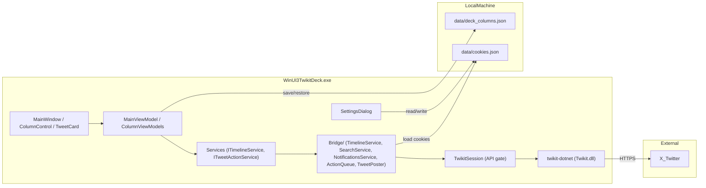

# WinUI-3-twikit-deck

**English summary:** A TweetDeck-style, multi-column WinUI 3 client for X (Twitter), backed by [twikit-dotnet](https://github.com/amanetoki7/twikit-dotnet) (a C# port of twikit) running in-process. Columns: Home (For you / Latest), Notifications, Mentions, Search, List and User timeline (with Posts / Replies / Reposts / Media tabs). Each column refreshes on its own schedule, merges new tweets at the top, loads older tweets when scrolled to the bottom, and the whole layout is saved and restored. Supports like / retweet / reply / quote, posting with images, video or an animated GIF, and a media viewer. Requires Windows 10 2004+, the .NET 8 SDK, and Visual Studio 2022 17.13 or later with the Windows application development workload. Quick start: clone with `--recurse-submodules` (`twikit-dotnet` is a git submodule) → copy `data/cookies.example.json` to `data/cookies.json` and fill in your cookies → open the solution, set `WinUI3TwikitDeck (Package)` as the startup project and run.

---

WinUI 3 で動作する TweetDeck（X Pro）風の複数カラム X（旧 Twitter）クライアントです。X との通信は [twikit-dotnet](https://github.com/amanetoki7/twikit-dotnet)（Python 製 twikit の C# 移植）をアプリ内で直接呼び出して行います。Python や FastAPI などの橋渡しサーバーは不要です。[WinUI-3-twikit](https://github.com/yukari-557fd8/WinUI-3-twikit) の Bridge 層を土台に、カラム型 UI として作り直したものです。

> **twikit-dotnet について:** 本プロジェクトは [amanetoki7/twikit-dotnet](https://github.com/amanetoki7/twikit-dotnet) をプロジェクト参照で取り込みます。NuGet には公開されていないため、リポジトリ直下の `twikit-dotnet/` に **git submodule** として含めています。clone 時に `--recurse-submodules` を付けるか、clone 後に `git submodule update --init --recursive` を実行してください。別の checkout を使う場合は環境変数 `TWIKIT_DOTNET_DIR` でパスを上書きできます。

> **注意:** これは非公式クライアントです。X の仕様変更により予告なく動作しなくなる可能性があります。利用は自己責任でお願いします。

## 機能

### カラム

「カラムを追加」メニューから好きな種類のカラムを何本でも並べられます。

| カラム | 内容 |
|---|---|
| ホーム | おすすめ / 最新のタブ切り替え |
| 通知 | いいね・リポスト・フォローなどの集約通知と、返信・引用のツイートカード |
| メンション | 自分宛ての返信・メンション |
| 検索 | 検索語を入力して追加（X の検索演算子も使用可） |
| リスト | ログイン中アカウントのリストから選んで追加 |
| ユーザー | `@スクリーンネーム` を入力して追加。ツイート（オリジナルのみ）/ 返信 / リポスト / メディア（写真・動画をプルダウンで切り替え）のタブ。プロフィールの固定ツイートは「固定されたツイート」として先頭に固定 |

本文中のハッシュタグをクリックすると検索カラム、`@メンション` をクリックするとユーザーカラムが追加されます。URL は既定のブラウザで開きます。

### カラムの管理

- カラムごとの自動更新（手動 / 1 分 / 2 分 / 5 分）。更新時は新着だけを先頭に差し込み、既存ツイートのカウントやいいね状態を最新化します
- 末尾までスクロールすると続きを自動取得（「さらに読み込む」ボタンでも可）
- 幅（狭い / 標準 / 広い）、左右への移動、閉じる
- 開いているカラムの種類・順序・タブ・更新間隔・幅は `data/deck_columns.json` に保存され、次回起動時に復元されます
- 上部左に `Twikit: Ready ✅ (@ユーザー名)` の接続状態と時計を表示

### ツイート操作

- いいね / いいね解除、リポスト / リポスト取り消し、返信、引用、ブラウザで開く
- いいね・リポストは **アクションキュー**（`Bridge/ActionQueue.cs`）で順次送信します。UI は即時反映し、送信に失敗したときは元の状態へ戻して上部の通知バーに表示します

### 投稿

- 新規ツイート（`Ctrl+N`）、返信、引用を 1 つのダイアログで。`Ctrl+Enter` で送信
- 画像 4 枚まで、または動画 1 本、またはアニメーション GIF 1 件。画像は `Ctrl+V` でも添付可
- 動画（`tweet_video`）と GIF（`tweet_gif`。X 側で mp4 に変換）はチャンクアップロードで X の処理完了を待ち、ファイルごとの進捗を表示

### メディア表示

- 1〜4 枚の画像グリッド、動画 / GIF のサムネイルに再生アイコンを重ねて表示
- クリックで拡大表示（ズーム可）または埋め込み再生（GIF はミュートでループ）
- 引用ツイートはカード内に表示（本文のリンク化・メディアも対応）

### キーボード

| キー | 動作 |
|---|---|
| `Ctrl+N` | 新規ツイート |
| `F5` / `Ctrl+R` | すべてのカラムを更新 |
| `Ctrl+Enter`（投稿ダイアログ内） | 送信 |

## アーキテクチャ



- カラムは `ViewModels/ColumnViewModelBase.cs` を基底とし、種類ごとに `Home` / `Search` / `Notifications` / `List` / `User` の ViewModel があります。初回は全件入れ替え、更新は先頭マージ、末尾到達時は続きを追加、という 3 つの取得経路を共通化しています
- 読み取りは `Services/ITimelineService`（実装 `RealTwikitClient`）、書き込みは `Services/ITweetActionService`（実装 `RealTweetActionService`）を通します。`data/cookies.json` が無いときはモック実装（`MockTwikitClient` / `MockTweetActionService`）に切り替わり、サンプルデータで UI を確認できます
- twikit-dotnet の `Client` はスレッド安全ではないため、X への呼び出しはすべて `Bridge/TwikitSession.cs` の `RunAsync`（セマフォ）で 1 件ずつ直列化しています。複数カラムを同時に読み込んでも衝突しません
- ページ送りは `Bridge/PageCursorStore.cs` が発行するトークン（`bridge:...`）で行い、twikit-dotnet の `Result<T>` を保持して続きを返します。通知は Bridge 側が種別ごとにカーソルを持ちます
- 認証情報は `data/cookies.json` に保存（設定ダイアログと Bridge で共有）。ファイルを更新すると次のリクエストから自動的に再読込されます

### Bridge 層の構成

| ファイル（`frontend/WinUI3TwikitDeck/WinUI3TwikitDeck/Bridge/`） | 役割 |
|---|---|
| `TwikitSession.cs` | twikit-dotnet の `Client` と Cookie の管理、API 呼び出しの直列化（`RunAsync`） |
| `TwikitBridge.cs` | 起動・再起動（ログイン確認）と接続状態の通知 |
| `TweetSerializer.cs` | ツイート → JSON 変換（本文・URL エンティティ・メディア・引用） |
| `TimelineService.cs` | ホーム / リスト / ユーザーツイート（種別・固定ツイートの判定を含む） |
| `SearchService.cs` | ツイート検索 |
| `NotificationsService.cs` | 通知・メンション |
| `ProfileService.cs` | プロフィール |
| `ActionQueue.cs` | いいね・リポスト・返信のキュー（結果を UI へ返す） |
| `TweetJobs.cs` / `TweetPoster.cs` / `MediaUpload.cs` | 投稿ジョブ・画像 / 動画 / GIF のアップロードと進捗 |
| `PageCursorStore.cs` | ページ送り用カーソル |
| `DeckLayoutStore.cs` | カラム構成（`deck_columns.json`）の保存・復元 |
| `RepositoryPaths.cs` | `cookies.json` などのパス解決 |

## 必要条件

| 項目 | 内容 |
|---|---|
| OS | Windows 10 バージョン 2004（ビルド 19041）以降。Windows 11 推奨 |
| .NET | **.NET 8 SDK 8.0.425 以降の 8.0.x**（`global.json` で固定、`rollForward: latestFeature`） |
| IDE | **Visual Studio 2022 17.13 以降**（`.slnx` 形式のソリューションに必要。Visual Studio 2026 でも可）+「.NET デスクトップ開発」「Windows アプリケーション開発」ワークロード |
| Windows SDK | 10.0.26100（パッケージ プロジェクトの `TargetPlatformVersion`。上記ワークロードで導入） |
| Windows App SDK | 1.6（NuGet から復元。実行時の Windows App Runtime は Visual Studio の配置時に自動インストール） |
| twikit-dotnet | [amanetoki7/twikit-dotnet](https://github.com/amanetoki7/twikit-dotnet) を git submodule（`twikit-dotnet/`）として取得（`net8.0` でビルド、依存パッケージ AngleSharp / Jint は NuGet から自動復元） |

Python、pip、uvicorn は不要です。

### 動作確認環境（開発時）

| 項目 | バージョン |
|---|---|
| OS | Windows 11 |
| Visual Studio | 2026（18.10） |
| .NET SDK | 8.0.425 |
| Windows App SDK | 1.6.250108002 |

### 環境差について

Visual Studio のマイナーバージョンが開発環境と異なっても、上記の必要条件が揃っていれば動作する想定です。失敗の多くは次の不足が原因です。

- .NET 8 SDK が未インストール、または 8.0.425 より古い
- 「Windows アプリケーション開発」ワークロード（WinUI 3 / Windows SDK 10.0.26100）が未インストール
- `twikit-dotnet` サブモジュールが初期化されていない（`twikit-dotnet/` が空。`git submodule update --init --recursive` を実行）
- `data/cookies.json` が未作成、またはトークン期限切れ

## リポジトリ構成

```
WinUI-3-twikit-deck/
├── frontend/
│   └── WinUI3TwikitDeck/
│       ├── WinUI3TwikitDeck.slnx          # Visual Studio ソリューション（twikit-dotnet も含む）
│       ├── WinUI3TwikitDeck/              # WinUI 3 アプリ本体
│       │   ├── Bridge/                    # twikit-dotnet とのやり取り
│       │   ├── Services/                  # 読み取り / 書き込みの抽象とモック
│       │   ├── ViewModels/                # Deck とカラムの ViewModel
│       │   ├── Models/                    # ツイート・通知・カラム定義
│       │   ├── Controls/                  # カラム、ツイートカード、投稿・設定ダイアログ
│       │   ├── Compose/                   # 添付メディアの選択・貼り付け
│       │   ├── Helpers/                   # 画像キャッシュ、本文パーサー、ログ
│       │   └── AfterMicrosoftNetSdk.targets  # パッケージ ビルド時の RID 伝播回避
│       └── WinUI3TwikitDeck (Package)/    # MSIX パッケージ（スタートアップ プロジェクト）
├── twikit-dotnet/              # git submodule（amanetoki7/twikit-dotnet。src/Twikit/Twikit.csproj を参照）
├── data/
│   └── cookies.example.json    # 認証情報テンプレート
└── global.json                 # .NET SDK のバージョン固定
```

## セットアップ

### 1. リポジトリの取得

twikit-dotnet は git submodule として含まれているため、`--recurse-submodules` を付けて clone します。

```powershell
git clone --recurse-submodules https://github.com/yukari-557fd8/WinUI-3-twikit-deck.git
cd WinUI-3-twikit-deck
```

すでに clone 済みで `twikit-dotnet/` が空の場合は、リポジトリ直下で次を実行します。

```powershell
git submodule update --init --recursive
```

twikit-dotnet の参照先コミットを進めるには `git submodule update --remote twikit-dotnet` を実行し、変更された `twikit-dotnet` を commit します。別の checkout を使いたい場合は、環境変数 `TWIKIT_DOTNET_DIR` にそのディレクトリ（`src/Twikit/Twikit.csproj` を含む）を設定すると上書きできます。

### 2. 認証情報の準備

```powershell
copy data\cookies.example.json data\cookies.json
```

`auth_token` と `ct0` は、ブラウザで x.com にログインした状態で取得します。

1. ブラウザの開発者ツールを開く（F12）
2. **Application**（または **ストレージ**）→ **Cookies** → `https://x.com`
3. `auth_token` と `ct0` の値をコピー
4. 次のいずれかの方法で設定する
   - `data/cookies.json` を直接編集して貼り付け
   - アプリの **設定** ダイアログに入力して **保存して適用** をクリック

`cookies.json` の形式:

```json
{
  "auth_token": "your_auth_token_here",
  "ct0": "your_ct0_here"
}
```

`data/cookies.json` が無い状態で起動すると設定ダイアログが開き、サンプルデータ（モック）で UI を確認できます。

> **重要:** `data/cookies.json` にはログイン情報が含まれます。**Git に commit しないでください**（`.gitignore` で除外済み）。

## 起動方法

### 方法 A: Visual Studio（推奨）

1. [frontend/WinUI3TwikitDeck/WinUI3TwikitDeck.slnx](frontend/WinUI3TwikitDeck/WinUI3TwikitDeck.slnx) を Visual Studio で開く（twikit-dotnet の `Twikit` プロジェクトも一緒に読み込まれます）
2. スタートアッププロジェクトを **WinUI3TwikitDeck (Package)** に設定
3. プラットフォーム **x64**、構成 **Debug** で実行（F5）。NuGet の復元、開発者モードでのパッケージ登録、Windows App Runtime の導入は Visual Studio が行います

### 方法 B: コマンドライン

Windows App SDK の PRI 生成タスクが Visual Studio 付属の MSBuild にしか無いため、`dotnet build` は `MSB4062 ... Microsoft.Build.Packaging.Pri.Tasks.dll` で失敗します。**Developer Command Prompt for VS** から `msbuild` を使ってください。

```powershell
msbuild frontend\WinUI3TwikitDeck\WinUI3TwikitDeck\WinUI3TwikitDeck.csproj -restore -p:Configuration=Debug -p:Platform=x64
```

ビルド後の実行は Visual Studio から行ってください（パッケージ アプリのため、生成された exe を直接起動することはできません）。

MSIX パッケージ プロジェクトは署名を無効（`AppxPackageSigningEnabled=false`）にしているため、ビルドやデバッグに証明書は不要です。配布用パッケージを作る場合は、パッケージ プロジェクトの設定で自分の署名証明書を指定してください。

### 起動時の挙動

- 起動時に `data/cookies.json` を読み込み、X にログインできるか確認します
- 上部左に `Twikit: Ready ✅ (@ユーザー名)` と表示されれば利用できます。失敗時は `❌` 付きの理由が表示されます
- 保存されたカラム構成（`data/deck_columns.json`）があれば復元し、無ければホームカラムを 1 本開きます
- 設定ダイアログで Cookie を保存するとセッションを作り直してログイン確認をやり直します

## データファイル

| ファイル | 内容 |
|---|---|
| `data/cookies.json` | `auth_token` / `ct0`。環境変数 `COOKIES_FILE` で場所を変更可 |
| `data/deck_columns.json` | 開いているカラムの種類・順序・タブ・更新間隔・幅。削除すると初期状態に戻る。環境変数 `DECK_COLUMNS_FILE` で場所を変更可 |
| `%LOCALAPPDATA%\WinUI3TwikitDeck\errors.log` | XAML のリソース参照失敗・バインド失敗・未処理例外の記録。パッケージ版では `%LOCALAPPDATA%\Packages\<パッケージ名>\LocalCache\Local\WinUI3TwikitDeck\errors.log` にリダイレクトされる |

## トラブルシューティング

| 症状 | 原因 | 対処 |
|---|---|---|
| ビルドエラー（WinUI / SDK 関連） | .NET 8 SDK または Windows アプリケーション開発ワークロード未導入 | [.NET 8 SDK](https://dotnet.microsoft.com/download/dotnet/8.0) をインストールし、VS インストーラーでワークロードを追加 |
| ビルドエラー `twikit-dotnet が見つかりません` / `Twikit.csproj が見つかりません` | サブモジュールが初期化されていない（`twikit-dotnet/` が空） | リポジトリ直下で `git submodule update --init --recursive` を実行する（別の場所を使う場合は環境変数 `TWIKIT_DOTNET_DIR` を設定） |
| `dotnet build` が `MSB4062` で失敗 | PRI 生成タスクが .NET SDK 単体には無い | Visual Studio から実行するか、Developer Command Prompt の `msbuild` を使う |
| `NETSDK1047: 資産ファイル ... に 'net8.0/win-x64' のターゲットがありません` | パッケージ プロジェクトが twikit-dotnet へ RID を伝播した | 通常は `AfterMicrosoftNetSdk.targets` が防ぎます。出た場合はソリューションを閉じて `twikit-dotnet/src/Twikit/obj` を削除し、再ビルド |
| 起動時に「.NET をインストールまたは更新する必要があります」 | 開発者モードで登録されたレイアウト（`WinUI3TwikitDeck (Package)\bin\x64\Debug\AppX`）に自己完結版とフレームワーク依存版のファイルが混在 | その `AppX` フォルダーを削除して Visual Studio から再実行 |
| `Twikit: cookies.json がありません ❌` | `data/cookies.json` が未作成 | `cookies.example.json` をコピーして値を入力し、設定ダイアログで保存 |
| `Twikit: Cookie が無効です ❌` | トークンの期限切れ・誤り | ブラウザから cookie を再取得し、設定ダイアログで更新する |
| `Twikit: 接続失敗 ❌` | ネットワーク、または X 側の制限 | 接続を確認して設定ダイアログから保存し直す。Cloudflare 等に拒否される場合は時間を置く |
| カラムに `The account is suspended or does not exist` | 存在しない・凍結・鍵付きのユーザー | スクリーンネームを確認する |
| 検索結果が常に空 | X がそのアカウントに検索結果を返していない（新規・制限中のアカウントなど） | 別のアカウントで確認する（Bridge 側の問題ではありません） |
| 投稿ダイアログにメディアのエラー | X がメディアを拒否（動画の長さ・形式など） | ダイアログ下部に X のメッセージがそのまま出るので内容に従う |

## セキュリティ

- `auth_token` と `ct0` はパスワードと同等の秘密情報です
- 公開リポジトリやスクリーンショットに含めないでください
- トークンが漏洩した場合は、X 側でセッションを無効化し、再取得してください

## ライセンス・免責

本プロジェクトは MIT ライセンスです（[LICENSE](LICENSE)）。twikit-dotnet も MIT ライセンスで配布されています。

本プロジェクトは非公式のクライアントです。X の利用規約および関連法令を遵守した上でご利用ください。作者は本ソフトウェアの利用によって生じた損害について一切の責任を負いません。

## 開発メモ

- twikit-dotnet は [amanetoki7/twikit-dotnet](https://github.com/amanetoki7/twikit-dotnet) をプロジェクト参照で使用（`WinUI3TwikitDeck.csproj` の `TwikitDotnetDir` プロパティ。既定は `..\..\..\twikit-dotnet\`）
- twikit-dotnet の `Client` はスレッド安全ではなく、複数カラムを同時に読み込むと `Collection was modified` になります。Bridge の呼び出しは必ず `TwikitSession.RunAsync` を通してください
- パッケージ プロジェクト（DesktopBridge）は参照プロジェクトへ `RuntimeIdentifier` を流したまま再帰するため、twikit-dotnet が `NETSDK1047` になります。`AfterMicrosoftNetSdk.targets` を `AfterMicrosoftNETSdkTargets` 経由で import し、再帰時に `RuntimeIdentifier` / `SelfContained` を外しています（ファイルを置くだけでは import されません）
- WinUI ライブラリ コントロール（`DropDownButton` など）の既定スタイルは `generic.xaml` 側にあり、App.xaml から `BasedOn="{StaticResource DefaultDropDownButtonStyle}"` では解決できません。遅延ロード時に `XamlParseException` となり、アプリはネイティブ側（`0xC000027B`）で落ちます。`errors.log` の `XamlResourceReferenceFailed` で確認できます
- cookie ファイルのパスは環境変数 `COOKIES_FILE`、リポジトリルートは `WINUI3TWIKITDECK_ROOT`（または `WINUI3TWIKIT_ROOT`）で指定できます。`RepositoryPaths.cs` は未作成時に姉妹リポジトリ `../WinUI-3-twikit/data/cookies.json` からのコピーも試みます（存在しなければ何もしません）
- アンパッケージ（`WindowsPackageType=None`）の自己完結ビルドは、開発環境では起動直後に `0xC0000374` で落ちることを確認しています。実行はパッケージ プロジェクトから行ってください
- タイムライン・検索・リスト・通知のツイートは `Bridge/TweetSerializer.cs` / `NotificationsService.cs` が同じ JSON 形式に変換し、`Models/TweetCardModel.cs` が読み込みます
- Bridge のログは `Debug.WriteLine` で出力されます（Visual Studio の出力ウィンドウ、Debug ビルドのみ）
